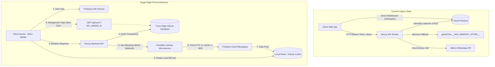
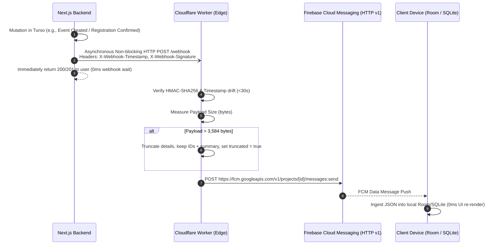
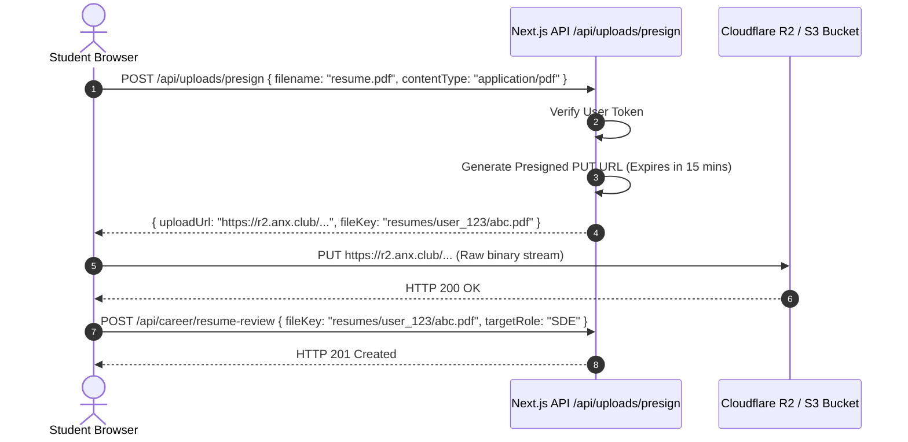

# ANX CLUB — Target Architecture Implementation Blueprint

**Document:** `TO_BE_IMPLEMENTED.md`  
**Purpose:** Comprehensive, stage-by-stage engineering roadmap for transitioning the ANX Club platform from legacy Firestore dependencies to the distributed edge-first target architecture.  
**Target Architecture:**
1. **Firebase Auth:** Strictly restricted to identity authentication, signup/login, and cryptographic ID token verification (`adminAuth.verifyIdToken`).
2. **Turso (Edge SQLite via `@libsql/client`):** Primary production operational database for all core entities (students, mentors, events, schedules, registrations, memberships, projects).
3. **Cloudflare Worker:** Low-latency edge microservice triggered by non-blocking backend webhooks to orchestrate FCM push notifications.
4. **FCM Data Payloads:** Structured JSON payloads dispatched directly to client devices.
5. **Client Local Cache:** Client-side local storage (Room/SQLite) ingesting FCM payloads directly for 0ms UI re-renders.
6. **Optimized Fallback Syncs:** Truncated FCM payloads (IDs + essential deltas) supplemented by on-click deep fetching and App-Open/Background delta syncs via `GET /api/sync?last_updated_at=...`.

## Core Architectural Mandate: Strict Decoupling & Separation of Frontend and Backend

A major flaw discovered in the legacy codebase is **monolithic coupling and layer bleeding**:
* Frontend components directly imported server-side database code (`firebase/firestore`, `db`).
* Server API routes (`/api/...`) and frontend UI pages (`/(dashboard)/...`) were bundled into the same Next.js runtime, encouraging developers to mix secrets, leak admin passwords into `localStorage`, and bypass API gates.

Under the target architecture, **the Frontend and Backend MUST BE STRICTLY DECOUPLED both logically and physically**:

```mermaid
graph TD
    subgraph Tier_1 [Tier 1: Standalone Client Application (Web / Mobile)]
        UI[User Interface / React Views / Native Screens]
        LocalCache[(Embedded Local Database: Room / SQLite / WASM)]
        FCMReceiver[FCM Push Receiver Service]
        FBClientAuth[Firebase Client Auth SDK (Login / Token Only)]
        UI -->|0ms Reactive Query| LocalCache
        FCMReceiver -->|Atomic Local Upsert| LocalCache
    end

    subgraph Tier_2 [Tier 2: Standalone Backend API Service (Headless)]
        APIGateway[REST & Sync API Route Handlers]
        FBAdminAuth[Firebase Admin SDK (Strictly verifyIdToken)]
        TursoClient[Turso Edge SQLite Driver: @libsql/client]
        WebhookDispatcher[HMAC Webhook Dispatcher]
        APIGateway -->|Verify Bearer Token| FBAdminAuth
        APIGateway -->|ACID SQL Queries| TursoClient
        APIGateway -->|Non-blocking Webhook| WebhookDispatcher
    end

    subgraph Tier_3 [Tier 3: Edge Microservice]
        CFWorker[Cloudflare Worker FCM Engine]
    end

    subgraph Cloud_Infrastructure [Managed Cloud Infrastructure]
        TursoCloud[(Turso Distributed Edge SQLite)]
        FCMService[Firebase Cloud Messaging HTTP v1]
    end

    %% Network Boundaries
    UI -->|HTTP Requests with Bearer Token| APIGateway
    UI -->|Interactive Sign-In / Token Refresh| FBClientAuth
    TursoClient -->|libsql:// wire protocol| TursoCloud
    WebhookDispatcher -->|Signed HMAC-SHA256 HTTP POST| CFWorker
    CFWorker -->|FCM HTTP v1 API JSON <= 4KB| FCMService
    FCMService -->|Push Notification Data Payload| FCMReceiver
```

### Strict Separation of Responsibilities

| Responsibility / Capability | Standalone Client Application (Frontend) | Standalone Backend API Service (Backend) | Cloudflare Worker Microservice |
| :--- | :--- | :--- | :--- |
| **Database Access** | **Strictly LOCAL ONLY** (Room / local SQLite). Zero access to Turso or cloud databases. | **Primary Operational DB** (Turso Edge SQLite via `@libsql/client`). | None (Stateless edge function). |
| **Database Drivers & Secrets** | **PROHIBITED.** Never imports `@libsql/client`, `firebase-admin`, or DB tokens. | Holds `TURSO_DATABASE_URL`, `TURSO_AUTH_TOKEN`, `FIREBASE_PRIVATE_KEY`. | Holds `WEBHOOK_HMAC_SECRET`, `FCM_SERVICE_ACCOUNT`. |
| **Authentication Scope** | Obtains ID token from Firebase Client SDK; attaches `Authorization: Bearer <token>`. | Cryptographically verifies ID token using `adminAuth.verifyIdToken(token)`. | Verifies `X-Webhook-Signature` HMAC. |
| **UI Rendering & State** | 0ms UI latency rendered directly from local Room/SQLite database. | **Headless.** Never renders HTML or React components; returns pure JSON. | None (API only). |
| **Data Synchronization** | Ingests incoming FCM push payloads into local SQLite; calls `GET /api/sync`. | Serves delta sync payloads based on `last_updated_at` query parameter. | Truncates payloads > 3.5KB to core IDs + deltas. |
| **Network Boundary** | Only calls public HTTPS endpoints (`/api/v1/...`, `/api/sync`). | Completely decoupled from presentation; callable by Web SPA, Android, iOS. | Invoked only by trusted backend webhooks. |

---

## Architecture Evolution: Current vs. Target



---

## Stage 1: Turso Edge SQLite Database Foundation & Data Layer Migration

### 1.1 Package Dependencies & Environment Setup
Install the official Turso LibSQL client driver and configure environment variables.

* **Dependencies to Install:**
  ```bash
  npm install @libsql/client
  npm install -D drizzle-kit  # Optional schema migration tool
  ```
* **Environment Variables Configuration (`.env.example` & `.env.local`):**
  ```env
  # ============================================
  # TURSO EDGE DATABASE (SQLITE)
  # ============================================
  TURSO_DATABASE_URL=libsql://anx-club-[org].turso.io
  TURSO_AUTH_TOKEN=ey...[turso-database-token]
  ```

### 1.2 Turso Client Connection Module
Create a robust, thread-safe database client in `src/lib/turso/client.ts`:

```typescript
import { createClient, Client } from '@libsql/client';

class TursoDatabase {
  private static instance: Client | null = null;

  public static getInstance(): Client {
    if (!this.instance) {
      const url = process.env.TURSO_DATABASE_URL;
      const authToken = process.env.TURSO_AUTH_TOKEN;

      if (!url) {
        throw new Error('[Turso] Missing TURSO_DATABASE_URL in environment configuration.');
      }

      this.instance = createClient({
        url,
        authToken: authToken || undefined,
      });
    }
    return this.instance;
  }
}

export const db = TursoDatabase.getInstance();
```

### 1.3 Complete Relational SQLite Schema DDL
Deploy normalized relational schemas with strict constraints, foreign keys, versioning, and indices.

```sql
-- ============================================
-- 1. USERS & STUDENTS TABLE
-- ============================================
CREATE TABLE IF NOT EXISTS users (
  id TEXT PRIMARY KEY,                       -- Matches Firebase Auth UID
  email TEXT UNIQUE NOT NULL,
  full_name TEXT NOT NULL,
  phone_number TEXT,
  role TEXT NOT NULL DEFAULT 'Member',       -- 'Member', 'Premium Member', 'Student Head', 'Mentor', 'Admin'
  membership_type TEXT NOT NULL DEFAULT 'free', -- 'free', 'premium'
  membership_expiry INTEGER,                 -- Unix epoch (ms)
  college_id TEXT,
  college_name TEXT,
  graduation_year TEXT,
  xp_total INTEGER NOT NULL DEFAULT 0,
  leadership_stage TEXT NOT NULL DEFAULT 'Member',
  referral_code TEXT UNIQUE,
  referred_by TEXT,
  version INTEGER NOT NULL DEFAULT 1,
  created_at INTEGER NOT NULL,               -- Unix epoch (ms)
  updated_at INTEGER NOT NULL                -- Unix epoch (ms)
);
CREATE INDEX IF NOT EXISTS idx_users_college ON users(college_id);
CREATE INDEX IF NOT EXISTS idx_users_role ON users(role);
CREATE INDEX IF NOT EXISTS idx_users_updated_at ON users(updated_at);

-- ============================================
-- 2. EVENTS TABLE
-- ============================================
CREATE TABLE IF NOT EXISTS events (
  id TEXT PRIMARY KEY,
  title TEXT NOT NULL,
  description TEXT,
  date TEXT NOT NULL,                        -- YYYY-MM-DD
  time TEXT,                                 -- HH:MM AM/PM
  duration_minutes INTEGER DEFAULT 60,
  venue TEXT,
  is_online INTEGER NOT NULL DEFAULT 0,
  meeting_link TEXT,
  category TEXT NOT NULL,                    -- 'workshop', 'webinar', 'hackathon', 'networking'
  event_type TEXT NOT NULL DEFAULT 'free',   -- 'free', 'paid', 'premium'
  price REAL NOT NULL DEFAULT 0,
  premium_price REAL NOT NULL DEFAULT 0,
  capacity INTEGER NOT NULL DEFAULT 100,
  seats_booked INTEGER NOT NULL DEFAULT 0,
  registration_deadline TEXT,
  registration_type TEXT DEFAULT 'internal', -- 'internal', 'external'
  external_registration_url TEXT,
  poster_url TEXT,
  speaker TEXT,
  speaker_bio TEXT,
  speaker_image TEXT,
  status TEXT NOT NULL DEFAULT 'Draft',      -- 'Draft', 'Published', 'Cancelled', 'Deleted'
  is_published INTEGER NOT NULL DEFAULT 0,
  is_active INTEGER NOT NULL DEFAULT 1,
  cancellation_reason TEXT,
  college_id TEXT,
  college_name TEXT,
  organizer_id TEXT NOT NULL,
  version INTEGER NOT NULL DEFAULT 1,
  created_at INTEGER NOT NULL,
  updated_at INTEGER NOT NULL
);
CREATE INDEX IF NOT EXISTS idx_events_date ON events(date);
CREATE INDEX IF NOT EXISTS idx_events_status ON events(status, is_published, is_active);
CREATE INDEX IF NOT EXISTS idx_events_updated_at ON events(updated_at);

-- ============================================
-- 3. EVENT REGISTRATIONS TABLE
-- ============================================
CREATE TABLE IF NOT EXISTS event_registrations (
  id TEXT PRIMARY KEY,                       -- Deterministic: `${event_id}_${user_id}`
  event_id TEXT NOT NULL REFERENCES events(id) ON DELETE CASCADE,
  user_id TEXT NOT NULL REFERENCES users(id) ON DELETE CASCADE,
  name TEXT NOT NULL,
  email TEXT NOT NULL,
  phone TEXT,
  college TEXT,
  team_name TEXT,
  team_members TEXT,
  payment_status TEXT NOT NULL DEFAULT 'free', -- 'free', 'pending', 'paid'
  payment_id TEXT,
  order_id TEXT,
  amount REAL NOT NULL DEFAULT 0,
  ticket_id TEXT UNIQUE,
  status TEXT NOT NULL DEFAULT 'confirmed',  -- 'confirmed', 'attended', 'cancelled'
  version INTEGER NOT NULL DEFAULT 1,
  created_at INTEGER NOT NULL,
  updated_at INTEGER NOT NULL,
  UNIQUE(event_id, user_id)                  -- Atomic protection against duplicate bookings
);
CREATE INDEX IF NOT EXISTS idx_reg_event ON event_registrations(event_id);
CREATE INDEX IF NOT EXISTS idx_reg_user ON event_registrations(user_id);
CREATE INDEX IF NOT EXISTS idx_reg_updated_at ON event_registrations(updated_at);

-- ============================================
-- 4. MENTORS & SCHEDULES TABLE
-- ============================================
CREATE TABLE IF NOT EXISTS mentors (
  id TEXT PRIMARY KEY,
  user_id TEXT REFERENCES users(id),
  full_name TEXT NOT NULL,
  email TEXT NOT NULL,
  title TEXT NOT NULL,
  company TEXT,
  bio TEXT,
  avatar_url TEXT,
  hourly_rate REAL NOT NULL DEFAULT 0,
  rating REAL DEFAULT 5.0,
  review_count INTEGER DEFAULT 0,
  skills_json TEXT NOT NULL DEFAULT '[]',     -- JSON array of strings
  is_available INTEGER NOT NULL DEFAULT 1,
  created_at INTEGER NOT NULL,
  updated_at INTEGER NOT NULL
);

CREATE TABLE IF NOT EXISTS mentor_bookings (
  id TEXT PRIMARY KEY,
  mentor_id TEXT NOT NULL REFERENCES mentors(id),
  mentor_name TEXT NOT NULL,
  member_id TEXT NOT NULL REFERENCES users(id),
  member_name TEXT NOT NULL,
  member_email TEXT NOT NULL,
  topic TEXT NOT NULL,
  scheduled_date TEXT NOT NULL,
  scheduled_time TEXT NOT NULL,
  message TEXT,
  meeting_link TEXT,
  is_paid INTEGER NOT NULL DEFAULT 0,
  amount REAL NOT NULL DEFAULT 0,
  status TEXT NOT NULL DEFAULT 'Pending',    -- 'Pending', 'Approved', 'Rejected', 'Completed'
  version INTEGER NOT NULL DEFAULT 1,
  created_at INTEGER NOT NULL,
  updated_at INTEGER NOT NULL
);
CREATE INDEX IF NOT EXISTS idx_mentor_bookings_member ON mentor_bookings(member_id);
CREATE INDEX IF NOT EXISTS idx_mentor_bookings_mentor ON mentor_bookings(mentor_id);

-- ============================================
-- 5. MEMBERSHIPS & PAYMENTS TABLE
-- ============================================
CREATE TABLE IF NOT EXISTS memberships (
  id TEXT PRIMARY KEY,
  user_id TEXT NOT NULL REFERENCES users(id),
  plan TEXT NOT NULL,                        -- 'monthly_149', 'annual_999'
  status TEXT NOT NULL DEFAULT 'active',     -- 'active', 'expired', 'cancelled'
  start_date INTEGER NOT NULL,
  end_date INTEGER NOT NULL,
  razorpay_payment_id TEXT,
  order_id TEXT,
  amount REAL NOT NULL,
  version INTEGER NOT NULL DEFAULT 1,
  created_at INTEGER NOT NULL,
  updated_at INTEGER NOT NULL
);
CREATE INDEX IF NOT EXISTS idx_memberships_user ON memberships(user_id);

CREATE TABLE IF NOT EXISTS payments (
  id TEXT PRIMARY KEY,                       -- Razorpay Payment ID or Order ID
  order_id TEXT NOT NULL,
  user_id TEXT NOT NULL REFERENCES users(id),
  payment_type TEXT NOT NULL,                -- 'membership', 'event'
  amount REAL NOT NULL,
  currency TEXT NOT NULL DEFAULT 'INR',
  status TEXT NOT NULL,                      -- 'created', 'paid', 'failed'
  razorpay_signature TEXT,
  created_at INTEGER NOT NULL,
  verified_at INTEGER
);

-- ============================================
-- 6. GAMIFICATION XP LEDGER TABLE
-- ============================================
CREATE TABLE IF NOT EXISTS xp_ledger (
  id TEXT PRIMARY KEY,
  user_id TEXT NOT NULL REFERENCES users(id),
  action_type TEXT NOT NULL,                 -- 'event', 'mentor', 'idea', 'referral', 'roadmap'
  xp_value INTEGER NOT NULL,
  source_ref_id TEXT NOT NULL,               -- Unique event ID, session ID, or milestone ID
  reason TEXT NOT NULL,
  awarded_by TEXT NOT NULL DEFAULT 'system',
  created_at INTEGER NOT NULL,
  UNIQUE(user_id, action_type, source_ref_id) -- Strict idempotency gate
);
CREATE INDEX IF NOT EXISTS idx_xp_user ON xp_ledger(user_id);

-- ============================================
-- 7. DELTA SYNC TOMBSTONES TABLE
-- ============================================
CREATE TABLE IF NOT EXISTS sync_tombstones (
  id INTEGER PRIMARY KEY AUTOINCREMENT,
  entity_type TEXT NOT NULL,                 -- 'events', 'event_registrations', 'mentor_bookings'
  entity_id TEXT NOT NULL,
  deleted_at INTEGER NOT NULL                -- Unix epoch (ms)
);
CREATE INDEX IF NOT EXISTS idx_tombstones_deleted_at ON sync_tombstones(deleted_at);
```

### 1.4 Data Migration & Parity Verification Script
Create `scripts/migrate-firestore-to-turso.ts` to ingest all current Firestore documents into Turso with zero data loss:

```typescript
// scripts/migrate-firestore-to-turso.ts
import { adminDb } from '../src/lib/firebase/admin';
import { db as turso } from '../src/lib/turso/client';

async function migrateCollection(collectionName: string, mapFn: (doc: any) => { sql: string; args: any[] }) {
  console.log(`Starting migration for collection: ${collectionName}...`);
  const snapshot = await adminDb.collection(collectionName).get();
  console.log(`Found ${snapshot.size} documents in ${collectionName}.`);

  const batchSize = 100;
  for (let i = 0; i < snapshot.docs.length; i += batchSize) {
    const chunk = snapshot.docs.slice(i, i + batchSize);
    const statements = chunk.map(doc => mapFn({ id: doc.id, ...doc.data() }));
    await turso.batch(statements, 'write');
    console.log(`Migrated ${Math.min(i + batchSize, snapshot.docs.length)} / ${snapshot.size}`);
  }
}
```

### 1.5 API Route Refactoring (Replacing `adminDb` with SQL Queries)
Every API route in `src/app/api/v1/**` must be updated to execute parameterized SQL:

* **Example: Atomic Event Registration (`src/app/api/v1/events/[id]/register/route.ts`):**
  ```typescript
  import { db } from '@/lib/turso/client';

  // Atomic reservation and registration within a single SQLite transaction
  const regId = `${eventId}_${userId}`;
  const now = Date.now();

  const transaction = await db.transaction('write');
  try {
    // 1. Check capacity and increment seats_booked atomically
    const updateResult = await transaction.execute({
      sql: `UPDATE events 
            SET seats_booked = seats_booked + 1, updated_at = ? 
            WHERE id = ? AND is_active = 1 AND status = 'Published' AND seats_booked < capacity`,
      args: [now, eventId]
    });

    if (updateResult.rowsAffected === 0) {
      await transaction.rollback();
      return NextResponse.json({ success: false, message: 'Event is fully booked or unavailable.' }, { status: 400 });
    }

    // 2. Insert registration with unique constraint
    await transaction.execute({
      sql: `INSERT INTO event_registrations (id, event_id, user_id, name, email, payment_status, status, created_at, updated_at)
            VALUES (?, ?, ?, ?, ?, ?, 'confirmed', ?, ?)`,
      args: [regId, eventId, userId, name, email, paymentStatus, now, now]
    });

    await transaction.commit();
  } catch (err: any) {
    await transaction.rollback();
    if (err.message?.includes('UNIQUE')) {
      return NextResponse.json({ success: false, message: 'You are already registered for this event.' }, { status: 409 });
    }
    throw err;
  }
  ```

---

## Stage 2: Firebase Auth Decoupling & Security Hardening

### 2.1 Confining Firebase Admin Strictly to `verifyIdToken`
1. **Refactor `src/lib/firebase/admin.ts`:**
   * Delete `adminDb` and `adminStorage` exports completely.
   * Restrict `FirebaseAdminSingleton` exclusively to `adminAuth`:
   ```typescript
   import * as admin from 'firebase-admin';

   if (admin.apps.length === 0) {
     admin.initializeApp({
       credential: admin.credential.cert({
         projectId: process.env.FIREBASE_PROJECT_ID,
         clientEmail: process.env.FIREBASE_CLIENT_EMAIL,
         privateKey: process.env.FIREBASE_PRIVATE_KEY?.replace(/\\n/g, '\n'),
       }),
     });
   }

   export const adminAuth = admin.auth();
   ```

### 2.2 Purging Insecure Mock Bypasses & Backdoors
1. **Remove Hardcoded Bypasses in `src/lib/auth.ts`:**
   * Delete all checks for `mock_admin`, `usr_rohit`, `default_user_123`, `admin_user`, `admin@algorithmaliens.com`.
   * Enforce authentic, cryptographically signed Firebase ID tokens:
   ```typescript
   export async function authenticate(request: Request): Promise<string | null> {
     const authHeader = request.headers.get("Authorization");
     if (!authHeader?.startsWith("Bearer ")) return null;
     const token = authHeader.split("Bearer ")[1].trim();

     try {
       const decoded = await adminAuth.verifyIdToken(token);
       return decoded.uid;
     } catch {
       return null;
     }
   }
   ```
2. **Purge Plaintext Admin Passwords:**
   * Delete `src/lib/admin-auth-config.ts` entirely.
   * Remove `anx_admin_password` and `anx_admin_mode` from browser `localStorage`.
   * Admin verification must rely strictly on Firebase Auth Custom Claims:
   ```typescript
   const decoded = await adminAuth.verifyIdToken(token);
   if (decoded.role !== 'Admin' && !decoded.admin) {
     return NextResponse.json({ error: 'Forbidden: Admin access required.' }, { status: 403 });
   }
   ```

### 2.3 Hardening Next.js Edge Middleware (`src/middleware.ts`)
* Replace unsafe `jose.decodeJwt()` with verification against Firebase public keys (Google JWKS):
```typescript
import { NextResponse, NextRequest } from 'next/server';
import * as jose from 'jose';

const JWKS = jose.createRemoteJWKSet(
  new URL('https://www.googleapis.com/service_accounts/v1/jwk/securetoken@system.gserviceaccount.com')
);

export async function middleware(request: NextRequest) {
  const authHeader = request.headers.get('Authorization');
  if (!authHeader?.startsWith('Bearer ')) {
    return NextResponse.next();
  }

  const token = authHeader.split('Bearer ')[1].trim();
  try {
    const { payload } = await jose.jwtVerify(token, JWKS, {
      issuer: `https://securetoken.google.com/${process.env.FIREBASE_PROJECT_ID}`,
      audience: process.env.FIREBASE_PROJECT_ID,
    });

    const requestHeaders = new Headers(request.headers);
    requestHeaders.set('x-user-id', String(payload.sub));
    requestHeaders.set('x-user-role', String(payload.role || 'Member'));

    return NextResponse.next({ request: { headers: requestHeaders } });
  } catch {
    return NextResponse.json({ error: 'Unauthorized: Invalid token signature' }, { status: 401 });
  }
}
```

---

## Stage 3: Cloudflare Worker Microservice & Non-Blocking FCM Webhook Pipeline

### 3.1 Cloudflare Worker Microservice Architecture



### 3.2 Cloudflare Worker Implementation (`cloudflare-fcm-worker/src/index.ts`)
Create a dedicated standalone Cloudflare Worker microservice:

```typescript
export interface Env {
  WEBHOOK_HMAC_SECRET: string;
  FIREBASE_PROJECT_ID: string;
  FCM_SERVICE_ACCOUNT: string; // JSON string
}

export default {
  async fetch(request: Request, env: Env): Promise<Response> {
    if (request.method !== 'POST') {
      return new Response('Method Not Allowed', { status: 405 });
    }

    // 1. Verify HMAC Signature
    const timestamp = request.headers.get('X-Webhook-Timestamp') || '';
    const signature = request.headers.get('X-Webhook-Signature') || '';
    const now = Date.now();

    if (Math.abs(now - Number(timestamp)) > 30000) {
      return new Response('Webhook Expired', { status: 401 });
    }

    const bodyText = await request.text();
    const encoder = new TextEncoder();
    const key = await crypto.subtle.importKey(
      'raw',
      encoder.encode(env.WEBHOOK_HMAC_SECRET),
      { name: 'HMAC', hash: 'SHA-256' },
      false,
      ['verify']
    );

    const verified = await crypto.subtle.verify(
      'HMAC',
      key,
      hexToBuf(signature),
      encoder.encode(`${timestamp}.${bodyText}`)
    );

    if (!verified) {
      return new Response('Invalid Signature', { status: 401 });
    }

    const payload = JSON.parse(bodyText);

    // 2. Enforce 4KB Payload Limit & Auto-Truncation
    let fcmData = { ...payload.data };
    const serializedBytes = encoder.encode(JSON.stringify(fcmData)).length;

    if (serializedBytes > 3584) { // 3.5KB safety threshold
      fcmData = {
        entity: payload.entity,
        entity_id: payload.entity_id,
        summary: payload.summary || 'Update available',
        truncated: 'true',
        version: String(payload.version || 1),
        updated_at: String(payload.updated_at || now),
      };
    }

    // 3. Dispatch to FCM HTTP v1 API
    const accessToken = await getGoogleOAuth2Token(env.FCM_SERVICE_ACCOUNT);
    const fcmResponse = await fetch(
      `https://fcm.googleapis.com/v1/projects/${env.FIREBASE_PROJECT_ID}/messages:send`,
      {
        method: 'POST',
        headers: {
          Authorization: `Bearer ${accessToken}`,
          'Content-Type': 'application/json',
        },
        body: JSON.stringify({
          message: {
            topic: payload.recipientTopic || `user_${payload.recipientId}`,
            data: fcmData,
          },
        }),
      }
    );

    return new Response(JSON.stringify({ success: true, fcmStatus: fcmResponse.status }), {
      headers: { 'Content-Type': 'application/json' },
    });
  },
};
```

### 3.3 Next.js Non-Blocking Webhook Dispatcher
Implement `src/lib/webhooks/dispatcher.ts`:

```typescript
import crypto from 'crypto';

export interface PushWebhookPayload {
  recipientId: string;
  recipientTopic?: string;
  entity: string;
  entity_id: string;
  summary: string;
  version: number;
  updated_at: number;
  data: Record<string, string>;
}

export function queuePushWebhook(payload: PushWebhookPayload): void {
  const workerUrl = process.env.CF_WORKER_URL;
  const secret = process.env.CF_WEBHOOK_SECRET;

  if (!workerUrl || !secret) {
    console.warn('[WebhookDispatcher] Missing CF_WORKER_URL or CF_WEBHOOK_SECRET.');
    return;
  }

  const timestamp = Date.now().toString();
  const rawBody = JSON.stringify(payload);
  const signature = crypto
    .createHmac('sha256', secret)
    .update(`${timestamp}.${rawBody}`)
    .digest('hex');

  // Fire-and-forget: execute asynchronously without awaiting
  fetch(workerUrl, {
    method: 'POST',
    headers: {
      'Content-Type': 'application/json',
      'X-Webhook-Timestamp': timestamp,
      'X-Webhook-Signature': signature,
    },
    body: rawBody,
  }).catch((err) => {
    console.error('[WebhookDispatcher] Failed to send push webhook to Cloudflare Worker:', err);
  });
}
```

---

## Stage 4: High-Performance Delta Sync Engine & Client Local Cache (Room / SQLite)

### 4.1 Delta Sync Endpoint (`src/app/api/sync/route.ts`)
Build an optimized synchronization endpoint supporting incremental delta syncs, cursors, and tombstones:

```typescript
import { NextRequest, NextResponse } from 'next/server';
import { db } from '@/lib/turso/client';
import { authenticate } from '@/lib/auth';

export async function GET(request: NextRequest) {
  const userId = await authenticate(request);
  if (!userId) {
    return NextResponse.json({ success: false, error: 'Unauthorized' }, { status: 401 });
  }

  const { searchParams } = new URL(request.url);
  const lastUpdatedAt = Number(searchParams.get('last_updated_at') || 0);
  const limit = Math.min(Number(searchParams.get('limit') || 250), 500);
  const serverSyncTimestamp = Date.now();

  try {
    // 1. Fetch modified events
    const eventsQuery = await db.execute({
      sql: `SELECT * FROM events WHERE updated_at > ? ORDER BY updated_at ASC LIMIT ?`,
      args: [lastUpdatedAt, limit],
    });

    // 2. Fetch modified registrations for this user
    const regQuery = await db.execute({
      sql: `SELECT * FROM event_registrations WHERE user_id = ? AND updated_at > ? ORDER BY updated_at ASC LIMIT ?`,
      args: [userId, lastUpdatedAt, limit],
    });

    // 3. Fetch tombstones (deleted items)
    const tombstonesQuery = await db.execute({
      sql: `SELECT entity_type, entity_id, deleted_at FROM sync_tombstones WHERE deleted_at > ? ORDER BY deleted_at ASC LIMIT ?`,
      args: [lastUpdatedAt, limit],
    });

    return NextResponse.json({
      success: true,
      server_timestamp: serverSyncTimestamp,
      has_more: eventsQuery.rows.length === limit || regQuery.rows.length === limit,
      changes: {
        events: eventsQuery.rows,
        registrations: regQuery.rows,
        tombstones: tombstonesQuery.rows,
      },
    });
  } catch (err: any) {
    console.error('[Sync API] Error executing delta query:', err);
    return NextResponse.json({ success: false, error: 'Internal Server Error' }, { status: 500 });
  }
}
```

### 4.2 Client-Side Local Cache Architecture (Room / SQLite)
Client devices (Mobile / Web via WASM SQLite or IndexedDB) must mirror the remote schema and execute atomic upserts.

#### Local SQLite Upsert Pattern with Monotonic Version Check:
```sql
INSERT INTO local_events (
  id, title, description, date, time, venue, category, event_type, 
  price, capacity, seats_booked, status, is_published, version, updated_at
) VALUES (
  :id, :title, :description, :date, :time, :venue, :category, :event_type, 
  :price, :capacity, :seats_booked, :status, :is_published, :version, :updated_at
)
ON CONFLICT(id) DO UPDATE SET
  title = excluded.title,
  description = excluded.description,
  date = excluded.date,
  time = excluded.time,
  venue = excluded.venue,
  category = excluded.category,
  event_type = excluded.event_type,
  price = excluded.price,
  capacity = excluded.capacity,
  seats_booked = excluded.seats_booked,
  status = excluded.status,
  is_published = excluded.is_published,
  version = excluded.version,
  updated_at = excluded.updated_at
WHERE excluded.version > local_events.version; -- Guarantees out-of-order pushes are ignored!
```

### 4.3 On-Click Deep-Linking & Skeleton Hydration for Truncated Payloads
* When a user taps a push notification marked `truncated: "true"`:
  1. The client UI renders the cached summary immediately (0ms latency).
  2. The detailed content view displays an animated skeleton placeholder.
  3. A background fetch is dispatched: `GET /api/v1/events/:id` or `GET /api/career/resume-review/:id`.
  4. The returned full record is written into the local database, and the UI transitions smoothly from skeleton to complete details.

---

## Stage 5: Frontend Refactoring & UI/UX Clutter Removal

### 5.1 Eliminating Client-Side Firestore WebSocket Listeners
1. **Refactor `src/components/NotificationBell.tsx`:**
   * Delete `onSnapshot(query(collection(db, "notifications")...))`.
   * Bind the notification badge directly to local reactive storage or query the delta sync API on app focus/resume.

### 5.2 Converting Fake UI Operations to Real Backend Endpoints
In `src/app/(admin)/admin/members/page.tsx`:
1. **Fix `handleToggleStatus`:**
   * Replace local-only state modification with a real API request to `POST /api/v1/admin/users/update-status`:
   ```typescript
   const handleToggleStatus = async (id: string, current: string) => {
     const next = current === 'active' ? 'suspended' : 'active';
     try {
       const token = await getAuthToken(user);
       await fetch('/api/v1/admin/users/update-status', {
         method: 'POST',
         headers: {
           'Content-Type': 'application/json',
           Authorization: `Bearer ${token}`,
         },
         body: JSON.stringify({ userId: id, status: next }),
       });
       setMembers(prev => prev.map(m => m.id === id ? { ...m, status: next } : m));
       toast.success(`Account status updated to ${next}!`);
     } catch {
       toast.error('Failed to update status in database.');
     }
   };
   ```
2. **Fix `handleDelete`:**
   * Wire the delete button to `DELETE /api/v1/admin/users/:id` before removing the member from local state.

### 5.3 Timestamp Standardization
Replace all direct references to `doc.issueDate._seconds * 1000` with standard integer epoch formatting:

```typescript
// src/lib/utils/date.ts
export function formatUnixTimestamp(timestamp: number | string | null | undefined): string {
  if (!timestamp) return 'N/A';
  const epoch = typeof timestamp === 'string' ? Number(timestamp) : timestamp;
  if (isNaN(epoch)) return 'Invalid Date';
  return new Intl.DateTimeFormat('en-US', {
    month: 'short',
    day: 'numeric',
    year: 'numeric',
    hour: '2-digit',
    minute: '2-digit',
  }).format(new Date(epoch));
}
```

### 5.4 Cloudflare R2 / S3 Presigned URL File Upload Pipeline
Replace raw 10MB Base64 data URLs in `src/app/(dashboard)/career/page.tsx` with direct-to-object-storage uploads:



---

## Stage 6: Codebase Consolidation, Tech Debt Liquidation & Verification

### 6.1 Physical Separation into Decoupled Frontend and Backend Workspaces
Eliminate the nested `ANX-CLUB-main/ANX-CLUB-main` folder and structurally decouple the frontend and backend into clean, independent tiers (either via a Turborepo/pnpm monorepo or dedicated directories):

```
ANX-club/
├── apps/
│   ├── backend/                     # Dedicated Headless API Service
│   │   ├── src/
│   │   │   ├── api/                 # Pure REST & Sync Route Handlers
│   │   │   ├── lib/
│   │   │   │   ├── turso/           # Turso client (@libsql/client) & SQL queries
│   │   │   │   ├── auth/            # Firebase Admin SDK (verifyIdToken only)
│   │   │   │   └── webhooks/        # HMAC Webhook Dispatcher
│   │   │   └── schemas/             # DDL & database migration scripts
│   │   ├── .env.example             # TURSO_DATABASE_URL, FIREBASE_PRIVATE_KEY, CF_WEBHOOK_SECRET
│   │   ├── package.json             # Express / Fastify / Next API (Zero React/UI dependencies)
│   │   └── tsconfig.json
│   │
│   ├── frontend/                    # Standalone Web Application
│   │   ├── src/
│   │   │   ├── app/                 # Next.js / Vite React Presentation Views
│   │   │   ├── components/          # Reusable UI components & modals
│   │   │   ├── lib/
│   │   │   │   ├── api/             # HTTP Client calling Backend API with Bearer token
│   │   │   │   ├── firebase/        # Firebase Client Auth SDK ONLY
│   │   │   │   └── local-db/        # Client-side WASM SQLite / IndexedDB cache
│   │   │   └── providers/           # Auth and Query state providers
│   │   ├── .env.example             # NEXT_PUBLIC_API_URL, NEXT_PUBLIC_FIREBASE_API_KEY
│   │   ├── package.json             # React 18, Tailwind, Framer Motion (Zero DB drivers!)
│   │   └── tsconfig.json
│   │
│   └── cloudflare-fcm-worker/       # Standalone Edge Notification Microservice
│       ├── src/
│       │   └── index.ts             # Webhook validation, 4KB payload pruning, FCM dispatch
│       ├── wrangler.toml            # Cloudflare Worker configuration & secrets
│       └── package.json
│
├── packages/
│   └── shared-types/                # Shared TypeScript contracts, DTOs & response types
│       └── src/index.ts
├── package.json                     # Root workspace definition
└── turbo.json
```

#### Enforced Separation Rules:
1. **Zero Database Driver Leaks in Frontend:** The `apps/frontend` `package.json` must **NEVER** include `@libsql/client`, `firebase-admin`, or raw SQL query files. Any attempt by frontend code to query Turso directly will fail at compile time.
2. **Headless Backend:** The `apps/backend` service is completely headless. It receives HTTP requests, verifies ID tokens with Firebase Admin, executes ACID transactions against Turso, queues webhooks, and returns JSON. It contains zero HTML, CSS, JSX, or browser cookies.
3. **Multi-Client Ready:** By completely decoupling the backend API, native mobile apps (Android with Room SQLite, iOS) can consume the exact same backend endpoints and FCM push payloads without touching web frontend code.

### 6.2 Workspace Hygiene & Root Directory Governance Policy

To prevent architectural entropy, configuration drift, and root directory pollution, the repository structure must strictly adhere to clean workspace governance:

```
┌────────────────────────────────────────────────────────────────────────────────────────┐
│                        CLEAN REPOSITORY GOVERNANCE PRINCIPLES                          │
├──────────────────────────┬─────────────────────────────────────────────────────────────┤
│ Directory                │ Permitted Content & Governance Rules                        │
├──────────────────────────┼─────────────────────────────────────────────────────────────┤
│ apps/frontend/           │ Strictly frontend code: React views, components, Tailwind,  │
│                          │ local SQLite/Room cache, Firebase Client Auth (login only). │
│                          │ ZERO backend secrets, ZERO DB drivers, ZERO server scripts. │
├──────────────────────────┼─────────────────────────────────────────────────────────────┤
│ apps/backend/            │ Strictly backend code: Headless API routes, Turso client,   │
│                          │ SQL migrations, Firebase Admin verifyIdToken, webhooks.     │
│                          │ All operational/seed scripts live in apps/backend/scripts/. │
├──────────────────────────┼─────────────────────────────────────────────────────────────┤
│ Root Directory           │ MUST REMAIN CLEAN of loose scripts & arbitrary config JSONs.│
│ (ANX-club/)              │ • NO stray scripts: replace_pages.js, generate_prd_docx.py, │
│                          │   create-admin.ts, backfill scripts are PROHIBITED in root. │
│                          │ • NO loose infrastructure configs: firestore.indexes.json,  │
│                          │   firestore.rules, or nested lockfiles in root.             │
│                          │ • Permitted root configs: package.json, turbo.json,         │
│                          │   .gitignore, .env.example.                                 │
├──────────────────────────┼─────────────────────────────────────────────────────────────┤
│ Exempted Root Files      │ Human-authored documentation, operational work logs, and    │
│ (Explicit Exemption)     │ planning artifacts are welcomed and EXEMPTED in the root:   │
│                          │ • Markdown documentation (*.md: README.md, Analysis_Results,│
│                          │   TO_BE_IMPLEMENTED.md, Roadmaps, Audits).                  │
│                          │ • Plaintext tracking & logs (*.txt: WORK_LOG, summaries).   │
└──────────────────────────┴─────────────────────────────────────────────────────────────┘
```

### 6.3 Dead Code & Redundant Module Pruning
1. **Delete Abandoned Express Server:**
   * Remove `src/modules/module1/` completely.
2. **Consolidate Submodule UI Components:**
   * Move `src/modules/module4/components/*`, `module5/*`, and `module6/*` into `src/components/events/`, `src/components/mentors/`, and `src/components/projects/`.
3. **Delete Cloned API Routes:**
   * Remove `src/modules/module3/app/api/**` (duplicate copies of routes).
4. **Purge In-Memory Mock Store:**
   * Delete `src/lib/memory-store.ts` and ensure all API routes return genuine 404/500 statuses if database records do not exist.

### 6.4 Automated In-Memory SQLite Testing Suite
Configure Jest to run against an in-memory SQLite database (`:memory:`) using `@libsql/client`:

```typescript
// __tests__/setup/turso-memory.ts
import { createClient } from '@libsql/client';

export const testDb = createClient({
  url: ':memory:',
});

beforeAll(async () => {
  // Execute DDL schema creation in test memory
  await testDb.executeMultiple(DDL_SCHEMA_STRING);
});

afterEach(async () => {
  // Truncate tables between tests for clean state
  await testDb.executeMultiple(`
    DELETE FROM event_registrations;
    DELETE FROM events;
    DELETE FROM users;
  `);
});
```

---

## Milestone Execution & Dependency Gantt

```
Task ID   Stage Description                                Dependencies   Est. Duration
────────────────────────────────────────────────────────────────────────────────────────
M-1.1     Install @libsql/client & Turso client singleton   None           Day 1
M-1.2     Deploy Turso Relational Schema DDL                M-1.1          Day 1-2
M-1.3     Execute Firestore-to-Turso Backfill Script        M-1.2          Day 2-3
M-1.4     Refactor v1 Event & Registration Routes to SQL    M-1.3          Day 3-5

M-2.1     Strip Firestore from FirebaseAdminSingleton      M-1.4          Day 5
M-2.2     Purge Mock Bypasses in auth.ts & admin-auth.ts    M-2.1          Day 6
M-2.3     Implement JWKS Verification in middleware.ts      M-2.2          Day 6-7
M-2.4     Delete admin-auth-config.ts & Plaintext Passwords M-2.3          Day 7

M-3.1     Scaffold & Deploy Cloudflare FCM Worker           None           Day 4-6
M-3.2     Implement Non-Blocking Backend Webhook Dispatcher M-3.1          Day 7-8
M-3.3     Wire Webhooks to Turso Mutations (Events/Billing) M-3.2          Day 8-9

M-4.1     Build GET /api/sync Delta Sync Endpoint           M-1.4          Day 9-10
M-4.2     Implement sync_tombstones Deletion Tracking       M-4.1          Day 10
M-4.3     Configure Local Room/SQLite Monotonic Upsert Gate M-4.2          Day 11-12

M-5.1     Remove onSnapshot Listeners from NotificationBell M-3.3, M-4.3   Day 12-13
M-5.2     Fix Fake UI Mutations in admin/members/page.tsx   M-1.4          Day 13
M-5.3     Deploy R2 Presigned Uploads for PDF Resumes       M-1.4          Day 13-14

M-6.1     Flatten Nested Directory Structure               M-5.3          Day 14
M-6.2     Delete Dead Modules (module1, module3, memStore)  M-6.1          Day 14-15
M-6.3     Run Integration Test Suite on In-Memory SQLite    M-6.2          Day 15
────────────────────────────────────────────────────────────────────────────────────────
Total Estimated Implementation Window: 15 Working Days
```

---

## Rollback & Risk Mitigation Strategy

1. **Dual-Write Interceptor Safety Net:** During the first 72 hours of Stage 1, all mutations execute against Turso first and mirror to Firestore asynchronously. If a catastrophic issue occurs in Turso, reading traffic can be reverted to Firestore via an environment variable flag (`FEATURE_READ_TURSO=false`).
2. **Deterministic Foreign Key Constraints:** SQLite `PRAGMA foreign_keys = ON;` is enforced on all Turso connections to prevent orphan registrations, orphan payments, or broken user references.
3. **FCM Payload Truncation Guard:** The Cloudflare Worker guarantees that no payload exceeding 3,584 bytes is ever transmitted to FCM, eliminating `PAYLOAD_TOO_LARGE` message drops in cellular environments.
4. **Idempotency Safeguards:** Every write in Turso and local client SQLite uses monotonic version checks (`version > current_version`) and compound unique constraints (`UNIQUE(event_id, user_id)`), preventing double bookings, duplicate XP grants, and replay race conditions.

---
*End of Blueprint. Document finalized and saved to `TO_BE_IMPLEMENTED.md`.*
