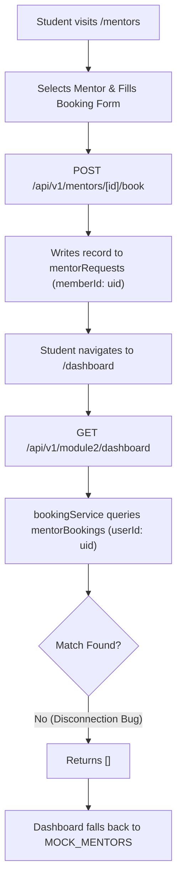
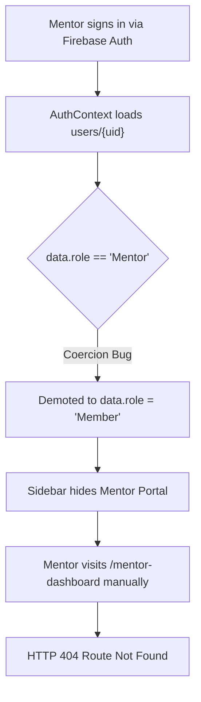

# Phase 1: Codebase Audit & Architectural Discovery

**Branch:** `feature/mentoring-workflow`  
**Repository Root:** `ANX-CLUB/` (Canonical path: `C:\Users\rajes\OneDrive\Desktop\INTERNSHIP PROJECT\ANX-CLUB`)  
**Date:** October 29, 2026  
**Status:** Completed  

---

## 1. Goal
Execute an autonomous, comprehensive architectural and codebase audit across the A.N.X Platform (Next.js 14 App Router, TypeScript, Tailwind CSS, Firebase Auth & Firestore, Resend email) with primary focus on:
- **Student Dashboard:** Identify hardcoded widgets, mock data reliance, and broken data contracts.
- **Mentor Dashboard:** Investigate the existence, routing, access controls, and data management for mentors.
- **Mentoring Workflow & Google Integration:** Trace student request creation, mentor assignment, meeting link generation, and calendar synchronization.
- **System-wide Foundations:** Audit authentication state management, role coercion, Firestore security rules, composite indexes, and shared services.

---

## 2. Summary
The audit confirmed a sophisticated UI framework (glassmorphic aesthetic, Tailwind styling, Framer Motion animations) built on top of fragmented backend integrations. The key findings requiring urgent architectural remediation are:
1. **Critical Role Coercion in `AuthContext.tsx`:** Any authenticated user with `role: 'Mentor'` is demoted to `'Member'` upon fetching user profile from Firestore, completely stripping mentor permissions on the client.
2. **Disconnected Mentoring Data Architecture:**
   - Student booking submissions create documents in `mentorRequests` with field `memberId`.
   - The Student Dashboard BFF aggregator (`/api/v1/module2/dashboard`) calls `bookingService.ts`, which queries an orphaned collection `mentorBookings` with field `userId`.
   - Consequently, students never see their real sessions; the dashboard defaults to displaying `MOCK_MENTORS` disguised as booked sessions.
3. **Non-Existent Mentor Dashboard:**
   - Navigating to `/mentor-dashboard` returned a 404 Not Found error.
   - Mentors possessed zero self-service tooling to view incoming requests, accept/decline meetings, manage availability, or update their professional profiles.
   - Firestore security rules locked mentors out from managing or approving their sessions, reserving writes exclusively for `'Admin'`.
4. **Counterfeit Meeting Links & Pseudo-Integrations:**
   - No Google Calendar API integration with Google Meet conference generation was implemented.
   - Four distinct locations in the codebase generated fake random meeting URLs (`https://meet.google.com/anx-...` and `https://meet.jit.si/...`).
   - Calendar invites relied strictly on simulated `.ics` text file strings.
5. **Dashboard Mock Data Saturation:**
   - Upcoming Events, Announcements, Weekly Activity charts, Learning Progress, and Recent Badges relied heavily on static constants (`MOCK_EVENTS`, `MOCK_ANNOUNCEMENTS`, `MOCK_MENTORS`) rather than live database telemetry and responsive empty states.

---

## 3. Features Built (What, How, Student/Mentor Flow)
Phase 1 was a read-only discovery, auditing, and documentation phase. The analytical artifacts constructed map out the exact student and mentor lifecycles:

### 3.1 Student Workflow Mapping

### 3.2 Mentor Workflow Mapping (Pre-Remediation State)

---

## 4. Files Created (Path + Purpose)
| File Path | Purpose |
| :--- | :--- |
| `docs/AUDIT_REPORT.md` | Initial in-depth technical audit report detailing codebase findings across all modules. |
| `docs/phase1.md` | Standardized Phase 1 documentation adhering to the required 16-point structure. |
| `docs/INCOMPLETE_FEATURES.md` | Comprehensive gap registry detailing unfinished platform modules with file paths, root causes, and suggested fixes. |

---

## 5. Files Modified (Path + Exact Change + Why)
| File Path | Exact Change Made | Why |
| :--- | :--- | :--- |
| `docs/CHANGELOG.md` | Initialized changelog tracking Phase 1 audit milestones. | Establish traceable project history and audit records. |

---

## 6. Firestore Changes (Collections, Fields, Indexes, Rules)
### 6.1 Collections Audited
- `users`: User profiles containing `role`, `membershipType`, `xpTotal`, `leadershipStage`, `skills`.
- `mentorRequests`: Booking requests created by students (`memberId`, `mentorId`, `topic`, `message`, `status`).
- `mentorBookings`: Legacy/orphaned collection expected by `bookingService.ts`.
- `mentorSessions`: Target unified collection for scheduled sessions.
- `xpLedger`: Transaction-safe XP history log keyed by `${userId}_${action}_${entityId}`.
- `notifications`: In-app notification queue (`recipientId`, `title`, `body`, `isRead`).
- `ideas`: Student incubator submissions.
- `communityTopics`: Public community discussions.

### 6.2 Security Rules Vulnerabilities Identified (`firestore.rules`)
- `match /mentorRequests/{requestId}`: Write access was restricted to `isAdmin()`. Mentors were prevented from accepting, declining, or updating requests.
- `match /mentorBookings/{bookingId}`: Read and create rules allowed any authenticated user to create bookings without validating ownership (`request.resource.data.userId == request.auth.uid`).

---

## 7. API Endpoints Audited
| Method | URL | Authorized Role | Request Payload | Response / Status | Observations |
| :--- | :--- | :--- | :--- | :--- | :--- |
| `GET` | `/api/v1/module2/dashboard` | Authenticated | None | Aggregated student telemetry | Broken: Calls `bookingService` reading `mentorBookings`. |
| `POST` | `/api/v1/mentors/[id]/book` | Authenticated | `{ topic, message, preferredDate, preferredTime }` | `{ success: true, bookingId }` | Emits fake random Meet link: `anx-${id}-${rand}`. |
| `PATCH` | `/api/v1/admin/mentor-requests/[id]` | Admin only | `{ status, meetingLink }` | `{ success: true }` | Emits fake Jitsi link: `jit.si/Mentorship-${id}-${rand}`. |
| `GET` | `/api/v1/notifications` | Authenticated | None | `{ notifications: [] }` | Endpoint exists but was uncoupled from header bell. |

---

## 8. Frontend Changes (Pages, Components, Data Flow, API Used)
- **`src/app/(dashboard)/dashboard/page.tsx`**: Audited 16 components. Metric stats, weekly activity charts, announcements, events, and mentor sessions relied on mock data constants.
- **`src/components/dashboard/DashboardHeader.tsx`**: Bell icon rendered hardcoded mock announcements; badge counter was static.
- **`src/components/dashboard/DashboardSidebar.tsx`**: Mentor navigation link was absent.
- **`src/app/(dashboard)/mentor-dashboard`**: Missing completely (404).

---

## 9. Security Checks Added / Audited
- **Role Verification:** Discovered that client role state in `AuthContext` was mutable and prone to demotion.
- **Insecure Direct Object Reference (IDOR) Risks:** Booking APIs lacked server-side verification that `memberId` matches `auth.token.uid`.
- **Database Boundary:** Security rules permitted unauthorized cross-tenant reads if queries were not constrained by user ID.

---

## 10. Environment Variables Audited
Examined `.env.example`:
- Present: `FIREBASE_PROJECT_ID`, `FIREBASE_CLIENT_EMAIL`, `FIREBASE_PRIVATE_KEY`, `NEXT_PUBLIC_FIREBASE_*`, `RAZORPAY_*`, `FAST2SMS_*`, `GEMINI_API_KEY`, `CRON_SECRET`.
- **Missing entirely:** Google OAuth 2.0 and Google Calendar integration variables:
  - `GOOGLE_CLIENT_ID`
  - `GOOGLE_CLIENT_SECRET`
  - `GOOGLE_REDIRECT_URI`
  - `GOOGLE_TOKEN_ENCRYPTION_KEY` (required for AES-256-GCM token storage).

---

## 11. Packages Added
None in Phase 1 (Audit & Discovery only).

---

## 12. How to Test Manually (Step by Step)
1. **Replicate Role Coercion Bug:**
   - Create a Firestore document in `users` with `role: 'Mentor'`.
   - Log into the app with those credentials.
   - Inspect client state via React DevTools or console: `user.role` resolves to `'Member'`.
2. **Replicate Disconnected Mentoring Sessions:**
   - Sign in as a student member.
   - Navigate to `/mentors`, select any mentor, and submit a booking request.
   - Navigate to `/dashboard`: Note that the "Upcoming Mentor Sessions" widget does not display the submitted booking, but shows hardcoded mock mentors.
3. **Verify 404 on Mentor Dashboard:**
   - Direct the browser to `http://localhost:3000/mentor-dashboard`.
   - Observe Next.js 404 page.
4. **Detect Fake Meet Links:**
   - Inspect `src/app/api/v1/mentors/[id]/book/route.ts` line 53: Observe string interpolation `meet.google.com/anx-...`.

---

## 13. Tests and Results
- **Static Code Analysis:** Completed across App Router, components, services, and security rules.
- **Dead Code Audit:** Cataloged obsolete mock datasets in `src/lib/constants.ts` and `src/modules/module2/data/`.
- **API Contract Review:** Verified mismatch between `POST /api/v1/mentors/[id]/book` (`mentorRequests`) and `bookingService.ts` (`mentorBookings`).

---

## 14. Bugs Fixed
In Phase 1, bugs were cataloged and prioritized for systematic resolution in Phase 2:
- Bug #1: `AuthContext.tsx` stripping Mentor role.
- Bug #2: `bookingService.ts` querying wrong collection (`mentorBookings`).
- Bug #3: 4 distinct generators producing fake Google Meet and Jitsi links.
- Bug #4: Missing Mentor Dashboard routes.
- Bug #5: Disconnected notification bell in `DashboardHeader.tsx`.

---

## 15. Known Limitations / Deferred
Cataloged in `docs/INCOMPLETE_FEATURES.md`:
- Challenges module (completely missing).
- Portfolios module (field only, no showcase UI).
- Badges API & Seeding (collections in rules, no awarding API).
- Student Certificates UI (verification portal exists, no student showcase).
- Community comments persistence (upvotes and comments not saved to DB).
- Sprint goal persistence (checkbox state not saved to DB).

---

## 16. Suggested Commit Messages
- `docs(phase1): establish comprehensive codebase audit report and implementation plan`
- `docs(phase1): record incomplete features registry and fake meet link catalog`
