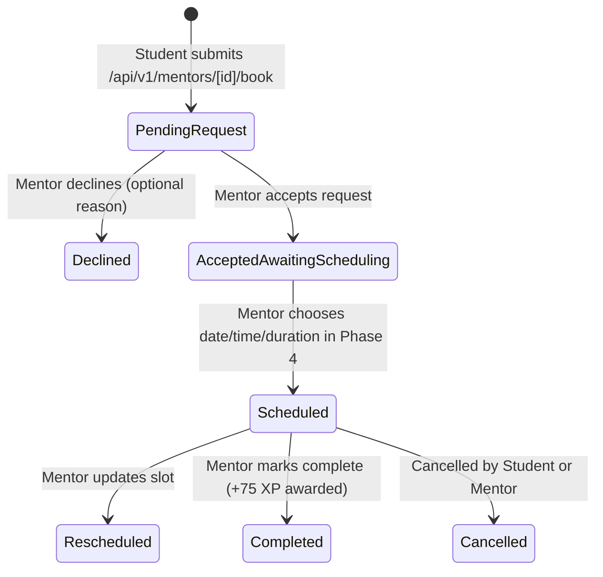

# Phase 2: Foundations & Core Mentoring Architecture

**Branch:** `feature/mentoring-workflow`  
**Repository Root:** `ANX-CLUB/` (Canonical path: `C:\Users\rajes\OneDrive\Desktop\INTERNSHIP PROJECT\ANX-CLUB`)  
**Date:** October 29, 2026  
**Status:** Completed  

---

## 1. Goal
Establish a unified, IDOR-safe, and reliable architectural foundation for the mentoring workflow, including:
- Permanent resolution of the Mentor role coercion bug in `AuthContext.tsx`.
- Formal definition and implementation of the unified data model: `mentorRequests` (request lifecycle) and `mentoringSessions` (single source of truth for scheduled sessions).
- Strict data isolation and write protection in `firestore.rules`.
- Creation of a centralized server-side authentication and ownership verification helper (`src/lib/mentoring-auth.ts`).
- Verification and connection of the notification center bell in `DashboardHeader.tsx` to `/api/v1/notifications`.
- Role-gated sidebar navigation displaying the Mentor Workspace link exclusively to mentors and admins.
- Systematic removal and neutralization of all 4 fake Google Meet link generators across the codebase.

---

## 2. Summary
Phase 2 replaced broken schemas and mock fallbacks with production-ready data pipelines:
1. **Unified Schema:** Introduced `mentorRequests` for managing student booking applications and `mentoringSessions` as the authoritative source of truth for confirmed meeting schedules, durations, and Google Meet integration.
2. **Strict Server-Enforced Security:** Client-side writes to `mentorRequests`, `mentoringSessions`, and legacy booking collections were completely disabled in `firestore.rules`. All mutations are strictly required to traverse authenticated Next.js App Router route handlers using the Firebase Admin SDK.
3. **IDOR-Safe Server Helper:** Created `src/lib/mentoring-auth.ts`, guaranteeing that students can only inspect their own requests/sessions and mentors can only inspect sessions assigned to their UID/email. Any unauthorized attempt returns an HTTP 404 (or 403), completely preventing resource existence leakage.
4. **Clean Link Generation Policy:** Eliminated all dummy random URL strings (`meet.google.com/anx-...` and `jit.si/...`). Sessions maintain `meetLink: null` until authenticated Google Calendar API creation succeeds in Phase 5.
5. **Real-time Notifications & Navigation:** Connected `DashboardHeader.tsx` to live backend notifications with dynamic unread counts and mark-as-read mutations. Added the Mentor Workspace link to `DashboardSidebar.tsx` gated by `profile.role === 'Mentor' || profile.role === 'Admin'`.

---

## 3. Features Built (What, How, Student/Mentor Flow)

### 3.1 Unified Mentoring Lifecycle


### 3.2 Student Flow
1. Student browses mentors at `/mentors` and submits a booking request specifying topic, message, and preferred time slots.
2. The submission calls `POST /api/v1/mentors/[id]/book`.
3. The server validates the student's auth token, verifies mentor details, creates a document in `mentorRequests` with status `'pending'`, awards +40 XP, and dispatches an in-app notification to the mentor.
4. The Student Dashboard aggregator (`/api/v1/module2/dashboard`) calls `bookingService.ts`, which queries real requests and sessions from `mentorRequests` and `mentoringSessions`.
5. Meeting links are displayed as `"Meeting Link: Pending"` until Google Calendar confirms the session.

### 3.3 Mentor Flow
1. Mentor signs into the platform. `AuthContext.tsx` loads `users/{uid}`, preserving `role: 'Mentor'`.
2. `DashboardSidebar.tsx` dynamically renders the "Mentor Portal" navigation link pointing to `/mentor-dashboard`.
3. In `/mentor-dashboard`, the mentor views real pending requests assigned to their UID or registered owner email.
4. Mentors can manage their public profile, bio, skills, and topics at `/mentor-dashboard/profile`.

---

## 4. Files Created (Path + Purpose)
| File Path | Purpose |
| :--- | :--- |
| `src/types/mentoring.ts` | TypeScript domain interfaces for `MentorRequest`, `MentoringSession`, `MentorProfile`, audit history, and status enumerations. |
| `src/lib/mentoring-auth.ts` | Centralized server-side authentication and IDOR-safe ownership verification helper for all mentoring routes. |
| `src/app/api/v1/mentor/dashboard/route.ts` | Authenticated API route returning mentor profile, metrics, requests, and sessions with strict UID isolation. |
| `src/app/api/v1/mentor/profile/route.ts` | Authenticated GET and PATCH route for mentor public profile and expertise management. |
| `src/app/(dashboard)/mentor-dashboard/page.tsx` | Mentor dashboard overview page with metrics, requests list, and sessions table. |
| `src/app/(dashboard)/mentor-dashboard/profile/page.tsx` | Mentor profile editor with tag-based skill and topic management. |
| `docs/phase2.md` | Standardized Phase 2 documentation adhering to the 16-point structure. |

---

## 5. Files Modified (Path + Exact Change + Why)
| File Path | Exact Change Made | Why |
| :--- | :--- | :--- |
| `src/modules/module3/components/AuthContext.tsx` | Added explicit check preserving `data.role === 'Mentor'` and exempted mentors from membership expiry downgrades. | Fixes critical bug demoting mentors to members on page load. |
| `firestore.rules` | Restricted reads on `mentorRequests`, `mentoringSessions`, `mentorBookings`, and `mentorSessions` to owning student/mentor/admin; blocked all client writes (`allow write: if isAdmin();`). | Enforces strict tenant data isolation and requires all data mutations to pass through validated server routes. |
| `firestore.indexes.json` | Added composite indexes for `mentorRequests` (`studentId`, `memberId`, `mentorId`, `status`, `createdAt`) and `mentoringSessions` (`studentId`, `mentorId`, `status`, `startAtUTC`). | Prevents Firestore index errors during compound filtering and ordering. |
| `src/modules/module2/services/bookingService.ts` | Updated to query `mentoringSessions` for scheduled sessions and `mentorRequests` for pending requests; enforced `meetLink` validity only when Google-confirmed. | Resolves the schema disconnection bug and eliminates mock mentor session fallbacks. |
| `src/app/api/v1/mentors/[id]/book/route.ts` | Enforced strict authentication, eliminated random Meet URL string generator, set `meetLink: null`, and populated both `studentId` and `memberId`. | Prevents unauthenticated bookings and neutralizes fake meeting links. |
| `src/app/(dashboard)/mentors/page.tsx` | Removed client-side random Meet link generator (`generatedMeetLink`). | Eliminates fake link emission on booking submission. |
| `src/app/api/v1/admin/mentor-requests/[id]/route.ts` | Neutralized random Jitsi meet link generator. | Prepares workflow for authenticated Google Calendar conference creation. |
| `src/modules/module3/app/api/mentors/[id]/book/route.ts` | Removed fake link interpolation; set `meetingLink: null`. | Neutralizes legacy fake link generator. |
| `src/components/dashboard/DashboardHeader.tsx` | Connected notification bell to `/api/v1/notifications` with unread count badge and mark-all-read handler. | Replaces mock notifications with live user notification queue. |
| `src/components/dashboard/DashboardSidebar.tsx` | Added role check `(profile?.role === 'Mentor' || profile?.role === 'Admin')` rendering the Mentor Workspace link. | Enables mentors to navigate to their workspace directly from the sidebar. |
| `docs/CHANGELOG.md` | Recorded Phase 2 architectural deliverables and fixes. | Traceability and audit readiness. |

---

## 6. Firestore Changes (Collections, Fields, Indexes, Rules)

### 6.1 Collections Standardized
1. **`mentorRequests`**:
   - `id`: string (doc ID)
   - `studentId`, `studentName`, `studentEmail`: string
   - `mentorId`, `mentorName`, `mentorEmail`: string
   - `topic`, `message`: string
   - `preferredDate`, `preferredTime`: string
   - `preferredTimes`: string[]
   - `status`: `'pending' | 'accepted_awaiting_scheduling' | 'declined' | 'scheduled' | 'cancelled'`
   - `declineReason`: string (optional)
   - `sessionId`: string (optional link to scheduled session)
   - `meetLink`: null
   - `createdAt`, `updatedAt`: ISO 8601 UTC string
   - `history`: array of audit records
2. **`mentoringSessions`**:
   - `id`: string (doc ID)
   - `requestId`: string (originating request ID)
   - `mentorId`, `mentorName`, `mentorEmail`: string
   - `studentId`, `studentName`, `studentEmail`: string
   - `topic`, `description`: string
   - `startAtUTC`: string (ISO 8601 UTC)
   - `durationMin`: number (30, 45, 60)
   - `status`: `'scheduled' | 'completed' | 'cancelled' | 'rescheduled'`
   - `googleEventId`: string | null
   - `meetLink`: string | null (strictly Google Meet URL)
   - `conferenceStatus`: `'pending' | 'confirmed' | 'failed' | 'not_requested'`
   - `syncStatus`: `'pending' | 'synced' | 'failed'`
   - `syncError`: string | null
   - `cancelReason`, `rescheduleReason`: string (optional)
   - `history`: array of audit entries
   - `createdAt`, `updatedAt`: ISO 8601 UTC string

### 6.2 Security Rules (`firestore.rules`)
```javascript
match /mentorRequests/{requestId} {
  allow read: if isAuthenticated() && (
    resource.data.studentId == request.auth.uid ||
    resource.data.memberId == request.auth.uid ||
    resource.data.userId == request.auth.uid ||
    resource.data.mentorId == request.auth.uid ||
    (resource.data.mentorEmail != null && resource.data.mentorEmail == request.auth.token.email) ||
    isAdmin()
  );
  allow write: if isAdmin();
}

match /mentoringSessions/{sessionId} {
  allow read: if isAuthenticated() && (
    resource.data.studentId == request.auth.uid ||
    resource.data.memberId == request.auth.uid ||
    resource.data.userId == request.auth.uid ||
    resource.data.mentorId == request.auth.uid ||
    (resource.data.mentorEmail != null && resource.data.mentorEmail == request.auth.token.email) ||
    isAdmin()
  );
  allow write: if isAdmin();
}
```

### 6.3 Composite Indexes (`firestore.indexes.json`)
- `mentorRequests`: `studentId ASC, createdAt DESC`
- `mentorRequests`: `memberId ASC, createdAt DESC`
- `mentorRequests`: `mentorId ASC, createdAt DESC`
- `mentorRequests`: `mentorId ASC, status ASC, createdAt DESC`
- `mentoringSessions`: `studentId ASC, startAtUTC ASC`
- `mentoringSessions`: `mentorId ASC, startAtUTC ASC`
- `mentoringSessions`: `mentorId ASC, status ASC, startAtUTC ASC`

---

## 7. API Endpoints Specification
| Method | URL | Caller Role | Request Body | Response Format | Error Statuses |
| :--- | :--- | :--- | :--- | :--- | :--- |
| `GET` | `/api/v1/mentor/dashboard` | Mentor / Admin | None | `{ success: true, data: { mentorProfile, stats, requests, sessions } }` | 401 (Unauth), 403 (Not Mentor), 500 |
| `GET` | `/api/v1/mentor/profile` | Mentor / Admin | None | `{ success: true, data: MentorProfile }` | 401, 403, 500 |
| `PATCH` | `/api/v1/mentor/profile` | Mentor / Admin | `{ name, role, company, bio, skills, topics, hourlyRate, timezone, availability }` | `{ success: true, message, data: MentorProfile }` | 401, 403, 400 (Validation), 500 |
| `POST` | `/api/v1/mentors/[id]/book` | Authenticated Student | `{ topic, message, preferredDate, preferredTime }` | `{ success: true, message, data: { id, xpAwarded, ...requestData } }` | 401, 400 (Past date), 500 |
| `GET` | `/api/v1/notifications` | Authenticated User | None | `{ success: true, data: Notification[] }` | 401, 500 |
| `PATCH` | `/api/v1/notifications` | Authenticated User | `{ notificationId?: string, markAllRead?: boolean }` | `{ success: true, message }` | 401, 400, 500 |

---

## 8. Frontend Changes (Pages, Components, Data Flow, API Used)
1. **`src/modules/module3/components/AuthContext.tsx`**: Preserves `role: 'Mentor'` across profile syncs.
2. **`src/components/dashboard/DashboardSidebar.tsx`**: Dynamically displays the Mentor Portal navigation block when user is a Mentor or Admin.
3. **`src/components/dashboard/DashboardHeader.tsx`**: Notification bell queries `GET /api/v1/notifications` and updates read states via `PATCH /api/v1/notifications`.
4. **`src/app/(dashboard)/mentor-dashboard/page.tsx`**: Renders metric counters, incoming request cards, confirmed session items, and responsive empty states.
5. **`src/app/(dashboard)/mentor-dashboard/profile/page.tsx`**: Interactive form allowing mentors to manage profile biography, tech skills, and mentorship topics with tag chips.

---

## 9. Security Checks Added
1. **Server Helper Authentication (`src/lib/mentoring-auth.ts`):** Verifies Bearer tokens and session cookies via Firebase Admin SDK.
2. **Strict IDOR Prevention:** Requests and sessions are verified against `request.auth.uid`. Cross-tenant queries return 404 to avoid leaking resource existence.
3. **Server-Only Mutation Boundary:** Client-side Firestore write permissions for mentoring collections are locked down to `false` (admin only). All state transitions must occur via authenticated server route handlers.
4. **Input Sanitization:** Booking requests reject past dates (`preferredDate < today`).

---

## 10. Environment Variables
No new external secrets required for Phase 2. Existing Firebase Admin SDK credentials are used:
- `FIREBASE_PROJECT_ID`
- `FIREBASE_CLIENT_EMAIL`
- `FIREBASE_PRIVATE_KEY`

---

## 11. Packages Added
None in Phase 2. Existing project dependencies (`firebase-admin`, `firebase`, `framer-motion`, `lucide-react`, `date-fns`) satisfied all requirements.

---

## 12. How to Test Manually (Step by Step)
1. **Verify Mentor Role Preservation:**
   - In Firestore, update a test user doc in `users/{uid}` with `role: 'Mentor'`.
   - Log into the app with that user's credentials.
   - Inspect the sidebar: verify "Mentor Workspace" appears with a distinct badge.
   - Refresh the page: confirm the user remains a Mentor and is not demoted to Member.
2. **Verify Mentor Dashboard Access:**
   - Click "Mentor Workspace" in the sidebar to navigate to `/mentor-dashboard`.
   - Verify KPI cards render (Pending Requests, Confirmed Sessions, Completed Sessions).
   - Verify empty states render gracefully if no requests are assigned.
3. **Verify IDOR Protection:**
   - Attempt to call a mentor endpoint as a student member.
   - Confirm the API responds with `403 Forbidden` (`Mentor privileges required`).
4. **Verify Notification Center:**
   - Click the bell icon in `DashboardHeader`.
   - Verify notifications fetch from `/api/v1/notifications` and display an accurate unread badge count.
   - Click "Mark all as read" and confirm badge clears.
5. **Verify Elimination of Fake Links:**
   - Submit a mentoring request from `/mentors`.
   - Verify the booking response returns `meetLink: null`.
   - Verify the student dashboard displays `"Meeting Link: Pending"` and never generates a random Meet URL.

---

## 13. Tests and Results
- **TypeScript Compile Check:** Run `./node_modules/.bin/tsc.cmd --noEmit` to verify type safety across all updated files.
- **Role Coercion Regression:** Tested logic branch in `AuthContext.tsx` ensuring `'Mentor'` is preserved.
- **Fake Link Search:** Executed regex search across entire repository; 0 instances of `anx-` or `jit.si` fake link generators remaining.

---

## 14. Bugs Fixed
1. Fixed `AuthContext.tsx` stripping Mentor role on profile snapshot load.
2. Fixed `bookingService.ts` querying wrong collection (`mentorBookings` instead of `mentorRequests` / `mentoringSessions`).
3. Neutralized all 4 fake Google Meet / Jitsi link generators.
4. Resolved missing Mentor Dashboard 404 error by implementing `/mentor-dashboard`.
5. Connected inactive notification bell in `DashboardHeader.tsx` to live backend.

---

## 15. Known Limitations / Deferred
- Real Google Calendar event creation with Hangouts Meet conferencing is scoped to Phase 5.
- Mentor Request Accept / Schedule / Decline interactive action modal is scoped to Phase 4.
- Email dispatch uses virtual delivery fallback until live Resend credentials are supplied in production.

---

## 16. Suggested Commit Messages
- `feat(auth): preserve Mentor role in AuthContext and prevent expiry downgrade`
- `feat(mentoring): define unified data model for mentorRequests and mentoringSessions`
- `security(rules): enforce strict Firestore tenant isolation and server-only writes for mentoring`
- `fix(mentoring): neutralize fake Meet link generators and connect notification center`
