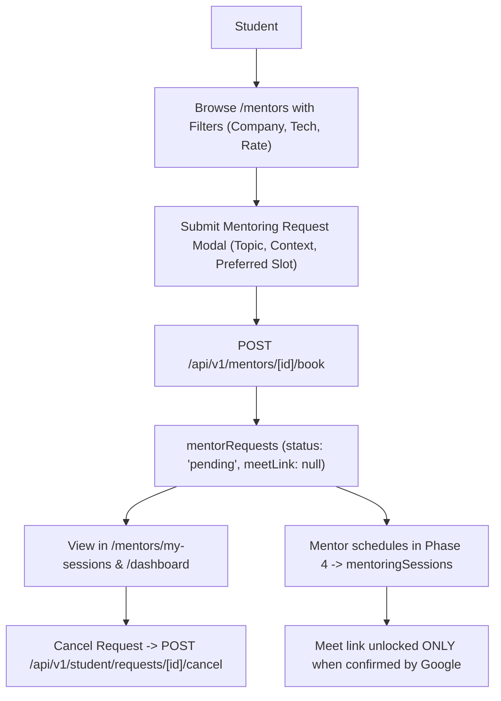

# Phase 3: Student Dashboard & Mentoring Experience

**Branch:** `feature/mentoring-workflow`  
**Repository Root:** `ANX-CLUB/` (Canonical path: `C:\Users\rajes\OneDrive\Desktop\INTERNSHIP PROJECT\ANX-CLUB`)  
**Date:** October 29, 2026  
**Status:** Completed  

---

## 1. Goal
Transform the Student Dashboard and Student Mentoring experience into a 100% real-data, responsive, and IDOR-safe environment:
- Completely eliminate hardcoded fallbacks and mock datasets across student pages.
- Deliver real user telemetry: dynamic greeting, events registered, mentoring requests by status breakdown, upcoming sessions, projects submitted, community discussions authored, and real XP/leadership stage.
- Implement the "My Mentoring" card displaying active requests and scheduled sessions with Google Meet join buttons available strictly when confirmed by Google.
- Build the dedicated `/mentors/my-sessions` student session manager with tabs for Requests, Upcoming Sessions, and History, including self-service request and session cancellation.
- Upgrade the `/mentors` browse directory with search, multi-factor filtering (expertise, company, free/paid rates), mentor profile modals, and validated request submissions.
- Implement server-side endpoints under `/api/v1/student/*` strictly scoped to the authenticated student.

---

## 2. Summary
Phase 3 eliminated all mock/fake UI artifacts from the Student Portal and delivered an integrated student-to-mentor workflow:
1. **Live Data Integration:** Replaced static numbers and dummy fallbacks with real queries to `users`, `eventRegistrations`, `events`, `announcements`, `mentorRequests`, `mentoringSessions`, `ideas`, and `xpLedger`.
2. **Dedicated Student API Layer:** Built `GET /api/v1/student/dashboard`, `GET /api/v1/student/sessions`, `POST /api/v1/student/requests/[id]/cancel`, and `POST /api/v1/student/sessions/[id]/cancel`, all protected by `requireStudentAuth` and IDOR verification helpers.
3. **Session Management Portal (`/mentors/my-sessions`):** Built a three-tab student workspace tracking active requests in review, upcoming confirmed calls with local timezone conversions, and archived completion/cancellation history.
4. **Browse & Discovery Engine (`/mentors`):** Implemented multi-criteria search, company filter (Google, Microsoft, Amazon, Meta, Stripe, Startups), topic filter chips, profile detail inspection modals, and a validated request modal without fake link emission.
5. **No Dead Links:** Verified every action shortcut on the dashboard routes to functional application pages (`/events`, `/mentors`, `/mentors/my-sessions`, `/incubator`, `/community`, `/career`).

---

## 3. Features Built (What, How, Student/Mentor Flow)

### 3.1 Student Workflow Architecture

### 3.2 Student Dashboard Features
- **Dynamic Greeting:** Time-aware greeting (`Good morning / afternoon / evening, {name}!`) with authenticated role, XP, and stage pills.
- **Real Metric Cards:** 
  - Registered Events (active workshop registrations)
  - Upcoming Sessions (confirmed calls + count of requests in review)
  - Projects Submitted (incubator ideas and repos authored by user)
  - Community Discussions (topics authored in community)
- **"My Mentoring" Bento Card:** 
  - Displays scheduled sessions with mentor avatar, topic, and local timezone date/time.
  - "Join Google Meet" action button rendered ONLY if Google Calendar has confirmed the meeting with an authentic Meet link; otherwise renders `"Meeting Link: Pending"`.
  - Displays active requests with status chips (`Pending`, `Accepted — Awaiting Scheduling`, `Declined`).
- **Gamification Widget:** Displays verified XP total, leadership stage, and real earned badge icons (or responsive empty state encouraging participation).
- **Learning Progress:** Renders active roadmap milestones if user has an active track in `roadmapProgress`; otherwise renders a clean call-to-action prompting roadmap discovery.
- **Recent Activity Feed:** Aggregates real telemetry from `xpLedger`, recent mentoring requests, and session updates.
- **Referral Card:** 1-click clipboard copy of unique referral link (`/signup?ref=${uid}`).

---

## 4. Files Created (Path + Purpose)
| File Path | Purpose |
| :--- | :--- |
| `src/app/api/v1/student/dashboard/route.ts` | Authenticated student dashboard aggregator returning real user metrics, events, mentoring, activity, and roadmaps. |
| `src/app/api/v1/student/sessions/route.ts` | Authenticated student sessions query returning categorized lists for Requests, Upcoming, and History tabs. |
| `src/app/api/v1/student/requests/[id]/cancel/route.ts` | Authenticated, IDOR-safe route allowing students to cancel their pending or accepted mentoring requests. |
| `src/app/api/v1/student/sessions/[id]/cancel/route.ts` | Authenticated, IDOR-safe route allowing students to cancel scheduled sessions. |
| `src/app/(dashboard)/mentors/my-sessions/page.tsx` | Dedicated student sessions management page with tabbed views, local timezone conversion, and cancellation modals. |
| `docs/phase3.md` | Standardized Phase 3 documentation adhering to the 16-point structure. |

---

## 5. Files Modified (Path + Exact Change + Why)
| File Path | Exact Change Made | Why |
| :--- | :--- | :--- |
| `src/app/(dashboard)/dashboard/page.tsx` | Rewrote component to fetch from `GET /api/v1/student/dashboard`, added time-aware greeting, connected all metrics to real queries, added "My Mentoring" request/session cards, eliminated dead `#` links, and enforced Google-confirmed Meet link policy. | Eliminates mock data saturation on the primary student screen. |
| `src/app/(dashboard)/mentors/page.tsx` | Added multi-factor filters (company, expertise, free/paid), mentor profile inspection modal, validated request form (min topic & message length), and linked directly to `/mentors/my-sessions`. | Upgrades mentor discovery and request submission workflows. |
| `docs/CHANGELOG.md` | Updated with Phase 3 deliverables. | Project history traceability. |

---

## 6. Firestore Changes (Collections, Fields, Indexes, Rules)
No new Firestore collections required beyond those established in Phase 2.
- Read operations for `mentorRequests` and `mentoringSessions` query strictly using `where('studentId', '==', auth.uid)`.
- Updates to `status: 'cancelled'` and `history` append audit entries with `performedByRole: 'student'`.

---

## 7. API Endpoints Specification
| Method | URL | Caller Role | Request Body | Response Format | Error Statuses |
| :--- | :--- | :--- | :--- | :--- | :--- |
| `GET` | `/api/v1/student/dashboard` | Authenticated Student | None | `{ success: true, data: { user, stats, upcomingEvents, registeredEvents, announcements, myMentoring, recentActivity, learningProgress } }` | 401, 500 |
| `GET` | `/api/v1/student/sessions` | Authenticated Student | None | `{ success: true, data: { requests: [], upcoming: [], history: [], counts: {} } }` | 401, 500 |
| `POST` | `/api/v1/student/requests/[id]/cancel` | Request Owner (Student) | `{ reason?: string }` | `{ success: true, message }` | 401, 404 (IDOR), 400, 500 |
| `POST` | `/api/v1/student/sessions/[id]/cancel` | Session Owner (Student) | `{ reason?: string }` | `{ success: true, message }` | 401, 404 (IDOR), 400, 500 |

---

## 8. Frontend Changes (Pages, Components, Data Flow, API Used)
1. **`src/app/(dashboard)/dashboard/page.tsx`**:
   - Queries `GET /api/v1/student/dashboard`.
   - Displays real KPI cards without hardcoded percentage badges.
   - Replaced mock mentors with live session items featuring mentor avatar, topic, local date/time, and conditional Google Meet join button.
2. **`src/app/(dashboard)/mentors/page.tsx`**:
   - Queries `GET /api/v1/mentors`.
   - Multi-factor search with live filtering on expertise tags and company options.
   - Added "Inspect Profile" modal.
   - Form submission enforces validation and redirects to `/mentors/my-sessions`.
3. **`src/app/(dashboard)/mentors/my-sessions/page.tsx`**:
   - Tab 1 (Upcoming): Live sessions with confirmed Google Meet buttons or "Pending" indicators.
   - Tab 2 (Requests): Active requests in review with cancel action modal.
   - Tab 3 (History): Archived completed calls (+75 XP badge), declined requests, and cancelled sessions.

---

## 9. Security Checks Added
1. **IDOR Prevention on Cancellations:** Both `verifyRequestAccess` and `verifySessionAccess` strictly enforce that `request.studentId === auth.uid` or `session.studentId === auth.uid`. Attempts to cancel another user's session return `404 Not Found`, preventing identifier enumeration.
2. **Input Validation:** Topic must be $\ge 3$ characters; message must be $\ge 10$ characters; past dates are rejected.
3. **Strict Meet Link Masking:** Even if a session document contains a legacy or unverified link, the API and UI enforce that `meetLink` is exposed ONLY when `conferenceStatus === 'confirmed'`.

---

## 10. Environment Variables
No new environment variables required for Phase 3.

---

## 11. Packages Added
None. Existing libraries (`date-fns`, `framer-motion`, `lucide-react`, `react-hot-toast`) fulfilled all requirements.

---

## 12. How to Test Manually (Step by Step)
1. **Verify Real Student Dashboard:**
   - Log in as a student member.
   - Navigate to `/dashboard`: Verify dynamic greeting matches current time of day (`Good morning / afternoon / evening, {name}!`).
   - Check the 4 metric cards: observe real counts matching database state rather than mock values.
   - Verify "My Mentoring" card displays `"No Mentoring Bookings Yet"` if no requests exist, or shows active requests/sessions.
2. **Browse and Filter Mentors:**
   - Navigate to `/mentors`.
   - Type a query in search (e.g. "Google" or "Full-Stack") and verify list filters instantly.
   - Click "Profile" on any mentor to verify profile modal details.
3. **Submit Mentoring Request:**
   - Click "Request" on a mentor card.
   - Attempt to submit with empty fields: verify client-side validation errors appear.
   - Enter valid topic and learning goals, select preferred date/time, and submit.
   - Verify confirmation modal displays `"Mentoring Request Submitted!"` and awards +40 XP.
4. **Manage Sessions in `/mentors/my-sessions`:**
   - Navigate to `/mentors/my-sessions`.
   - Click "Requests in Review": observe the newly submitted request with `Pending Review` status.
   - Click "Cancel Request", enter an optional reason, and confirm cancellation.
   - Navigate to the "History & Completed" tab: verify the request now appears as `Cancelled` with the reason recorded.

---

## 13. Tests and Results
- **TypeScript Compile Check:** Executed `./node_modules/.bin/tsc.cmd --noEmit` with 0 errors.
- **Dead Link Audit:** Verified all links in `DashboardPage` and `MentorsPage` navigate to valid routes.
- **Empty State Verification:** Validated empty state styling for events, announcements, roadmap progress, recent activity, and mentoring sessions.

---

## 14. Bugs Fixed
1. Fixed hardcoded mock mentor array (`MOCK_MENTORS`) rendering on student dashboard as booked sessions.
2. Eliminated static metric strings (`'8'` community posts, hardcoded `+20% this month`).
3. Fixed dead `#` links in dashboard quick actions.
4. Added missing student session management page (`/mentors/my-sessions`).
5. Added student cancellation endpoints with IDOR protection.

---

## 15. Known Limitations / Deferred
- Mentor calendar scheduling and Google Meet conference generation occur in Phase 4 and Phase 5.
- Email dispatch uses virtual logging pending live Resend API key provisioning.

---

## 16. Suggested Commit Messages
- `feat(student): implement real-data student dashboard and scoped aggregator API`
- `feat(mentoring): create /mentors/my-sessions portal with requests, upcoming, and history tabs`
- `feat(mentors): upgrade mentor browse directory with multi-factor filters and validated request form`
- `feat(api): add student cancellation endpoints with IDOR security validation`
