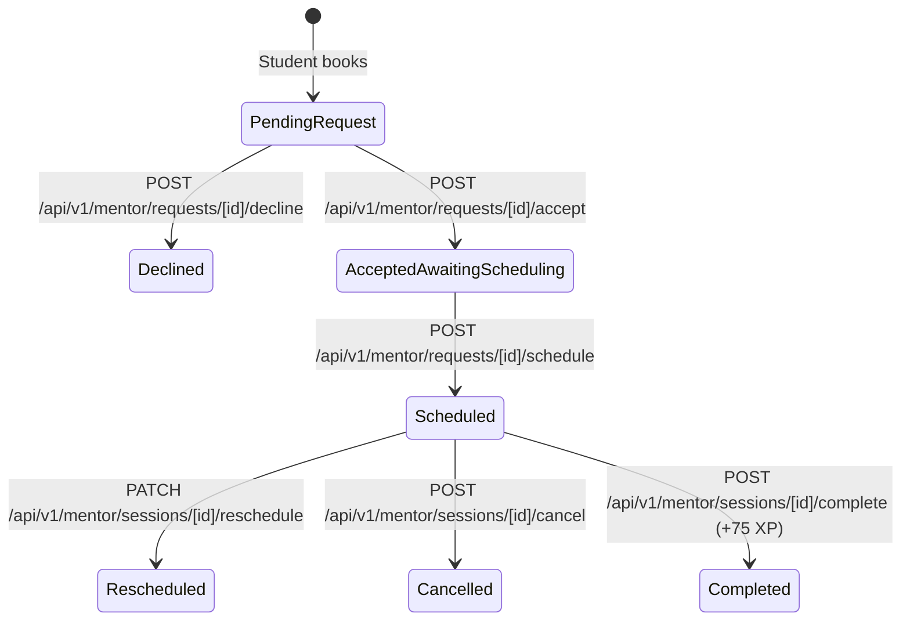

# Phase 4: Mentor Dashboard & Request Workflow

**Branch:** `feature/mentoring-workflow`  
**Repository Root:** `ANX-CLUB/` (Canonical path: `C:\Users\rajes\OneDrive\Desktop\INTERNSHIP PROJECT\ANX-CLUB`)  
**Date:** October 29, 2026  
**Status:** Completed  

---

## 1. Goal
Deliver a fully autonomous, server-enforced Mentor Workspace and scheduling pipeline:
- Build the `/mentor-dashboard` interface: overview metrics, next/today session spotlight, requests inbox, upcoming/history session lists, and agenda calendar view.
- Build the requests inbox workflow: Accept moves request to `accepted_awaiting_scheduling` and DOES NOT schedule a meeting; Decline records an optional reason.
- Build the scheduling workflow after accept: modal to choose date, time, and duration with validation (no past times, no mentor overlap, 15–120 min duration bounds, UTC storage, and local timezone display).
- Build session lifecycle actions: reschedule session, change duration, cancel session with reason, and mark complete awarding +75 XP via existing idempotent `awardMentorSessionXP`.
- Build the mentor profile editor at `/mentor-dashboard/profile`: biography, expertise tags, company, hourly rate, operating timezone, availability days & hours, and Google connection status card.
- Strictly enforce mentor authorization and tenant isolation on the server (`requireMentorAuth` and `verifySessionAccess`).

---

## 2. Summary
Phase 4 completed the mentor-side operating system:
1. **Server-Enforced Access Control:** Every mentor endpoint (`/api/v1/mentor/*`) strictly validates that the caller holds `'Mentor'` or `'Admin'` privileges, and IDOR verification ensures mentors only mutate sessions assigned to their own UID or verified owner email.
2. **Two-Stage Request Acceptance & Scheduling:** Decoupled request acceptance from meeting scheduling. Accepting moves a request to `accepted_awaiting_scheduling` without generating premature calendar events. Mentors then initiate a validated scheduling step.
3. **Double-Booking & Conflict Prevention:** The scheduling and rescheduling route handlers execute a server-side interval overlap check against all existing scheduled sessions for that mentor. Conflicting requests are rejected with HTTP 409 Conflict.
4. **Gamification & Completion Cycle:** Marking a session complete automatically invokes `awardMentorSessionXP`, awarding the student +75 XP idempotently, logging the transaction in `xpLedger`, and incrementing the mentor's completed sessions count.
5. **Availability & Profile Management:** Built `/mentor-dashboard/profile` enabling mentors to maintain their professional bio, rate, technical specializations, operating timezone, and working hours.

---

## 3. Features Built (What, How, Student/Mentor Flow)

### 3.1 Mentor Lifecycle Architecture

### 3.2 Key Capabilities
- **Overview Telemetry:** 4 metric cards (Requests in Inbox, Upcoming Sessions, Sessions Completed, Unique Students Mentored).
- **Spotlight Session Card:** Displays the immediate next session with student details, topic, local time, Join Meet link (if confirmed), and quick action buttons.
- **Inbox Queue:** Accept request moves status to `accepted_awaiting_scheduling`. Decline request opens a modal to specify a polite explanation.
- **Scheduling Modal:** Validates date $\ge$ today, duration between 15m and 120m, checks for mentor schedule overlaps, stores UTC timestamp in `mentoringSessions`, and updates `mentorRequests.status` to `'scheduled'`.
- **Session Actions:**
  - *Reschedule:* Modifies date and time with conflict detection.
  - *Duration:* Adjusts session duration (30, 45, 60, 90 mins).
  - *Cancel:* Records cancellation reason and notifies student.
  - *Mark Complete:* Idempotently awards student +75 XP and updates mentor records.
- **Agenda View:** Day-by-day calendar schedule of confirmed mentoring slots.
- **Profile & Availability Editor:** Self-service management of bio, skills, topics, timezone, working days, and hourly rate.

---

## 4. Files Created (Path + Purpose)
| File Path | Purpose |
| :--- | :--- |
| `src/app/api/v1/mentor/requests/[id]/accept/route.ts` | Authenticated route moving request to `accepted_awaiting_scheduling` and dispatching notifications. |
| `src/app/api/v1/mentor/requests/[id]/decline/route.ts` | Authenticated route declining requests with reason recording. |
| `src/app/api/v1/mentor/requests/[id]/schedule/route.ts` | Authenticated scheduling route validating bounds, checking mentor conflicts, creating session in `mentoringSessions`, and linking to originating request. |
| `src/app/api/v1/mentor/sessions/[id]/reschedule/route.ts` | Authenticated route updating session time with overlap prevention. |
| `src/app/api/v1/mentor/sessions/[id]/duration/route.ts` | Authenticated route updating session duration. |
| `src/app/api/v1/mentor/sessions/[id]/cancel/route.ts` | Authenticated route cancelling scheduled sessions with reason. |
| `src/app/api/v1/mentor/sessions/[id]/complete/route.ts` | Authenticated route marking session complete and awarding +75 XP to student. |
| `docs/phase4.md` | Standardized Phase 4 documentation adhering to the 16-point structure. |

---

## 5. Files Modified (Path + Exact Change + Why)
| File Path | Exact Change Made | Why |
| :--- | :--- | :--- |
| `src/app/api/v1/mentor/dashboard/route.ts` | Expanded aggregator to query `mentoringSessions`, return today's spotlight session, compute distinct student counts, and include Google Calendar connection state. | Provides complete data payload for mentor workspace. |
| `src/app/api/v1/mentor/profile/route.ts` | Added support for `timezone`, `availableDays`, `availableHours`, and `expertise` sync between `mentors` and `users` collections. | Enables comprehensive availability and profile management. |
| `src/app/(dashboard)/mentor-dashboard/page.tsx` | Implemented full interactive workspace: requests inbox, upcoming sessions, past history, agenda view, Google status banner, and modals for Accept, Decline, Schedule, Reschedule, Duration, Cancel, and Complete. | Delivers complete mentor dashboard UI. |
| `src/app/(dashboard)/mentor-dashboard/profile/page.tsx` | Added timezone selector, working days toggles, hours inputs, and Google Calendar connection status card. | Gives mentors self-serve availability tooling. |
| `docs/CHANGELOG.md` | Updated with Phase 4 deliverables. | Project history tracking. |

---

## 6. Firestore Changes (Collections, Fields, Indexes, Rules)
- `mentorRequests`:
  - `status`: transitions through `'pending'` $\rightarrow$ `'accepted_awaiting_scheduling'` $\rightarrow$ `'scheduled'` $\rightarrow$ `'declined'` / `'cancelled'`
  - `sessionId`: string (foreign key to `mentoringSessions`)
  - `declineReason`: string
  - `history`: array of audit entries
- `mentoringSessions`:
  - `id`: string (doc ID)
  - `requestId`: string
  - `mentorId`, `studentId`: string
  - `startAtUTC`: string (ISO 8601 UTC)
  - `durationMin`: number
  - `status`: `'scheduled'` | `'rescheduled'` | `'completed'` | `'cancelled'`
  - `meetLink`: null until Google confirms
  - `conferenceStatus`: `'pending'`
  - `syncStatus`: `'pending'`
  - `history`: array of audit entries
- `mentors`:
  - `timezone`: string
  - `availableDays`: string[]
  - `availableHours`: `{ start: string, end: string }`
  - `sessionsCompleted`: number (incremented upon completion)

---

## 7. API Endpoints Specification
| Method | URL | Caller Role | Request Body | Response Format | Error Statuses |
| :--- | :--- | :--- | :--- | :--- | :--- |
| `GET` | `/api/v1/mentor/dashboard` | Mentor / Admin | None | `{ success: true, data: { mentorProfile, stats, todayNextSession, requests, upcomingSessions, historySessions } }` | 401, 403, 500 |
| `POST` | `/api/v1/mentor/requests/[id]/accept` | Assigned Mentor | None | `{ success: true, message }` | 401, 404 (IDOR), 400, 500 |
| `POST` | `/api/v1/mentor/requests/[id]/decline` | Assigned Mentor | `{ reason?: string }` | `{ success: true, message }` | 401, 404 (IDOR), 400, 500 |
| `POST` | `/api/v1/mentor/requests/[id]/schedule` | Assigned Mentor | `{ date: 'YYYY-MM-DD', time: 'HH:mm', durationMin: 45 }` | `{ success: true, message, data: MentoringSession }` | 401, 404, 400, 409 (Conflict), 500 |
| `PATCH` | `/api/v1/mentor/sessions/[id]/reschedule` | Assigned Mentor | `{ date: 'YYYY-MM-DD', time: 'HH:mm', reason?: string }` | `{ success: true, message, data }` | 401, 404, 400, 409 (Conflict), 500 |
| `PATCH` | `/api/v1/mentor/sessions/[id]/duration` | Assigned Mentor | `{ durationMin: number }` | `{ success: true, message, data }` | 401, 404, 400, 500 |
| `POST` | `/api/v1/mentor/sessions/[id]/cancel` | Assigned Mentor | `{ reason?: string }` | `{ success: true, message }` | 401, 404, 400, 500 |
| `POST` | `/api/v1/mentor/sessions/[id]/complete` | Assigned Mentor | None | `{ success: true, message, data: { status, xpAwarded } }` | 401, 404, 500 |
| `GET` | `/api/v1/mentor/profile` | Mentor / Admin | None | `{ success: true, data: MentorProfile }` | 401, 403, 500 |
| `PATCH` | `/api/v1/mentor/profile` | Mentor / Admin | `{ name, role, company, bio, skills, topics, hourlyRate, timezone, availableDays, availableHours }` | `{ success: true, message, data }` | 401, 403, 500 |

---

## 8. Frontend Changes (Pages, Components, Data Flow, API Used)
1. **`src/app/(dashboard)/mentor-dashboard/page.tsx`**:
   - Queries `GET /api/v1/mentor/dashboard`.
   - Displays dynamic KPI stats cards and Google integration status banner.
   - Added Spotlight Card for the next upcoming session.
   - Built interactive modals for:
     - Accept Request $\rightarrow$ transitions state immediately.
     - Decline Request $\rightarrow$ reason textarea input.
     - Schedule Session $\rightarrow$ date, time, duration dropdown, UTC explanation.
     - Reschedule Session $\rightarrow$ new date/time picker with validation.
     - Change Duration $\rightarrow$ quick select buttons (30m, 45m, 60m, 90m).
     - Cancel Session $\rightarrow$ cancellation confirmation with reason.
     - Mark Complete $\rightarrow$ awards +75 XP confirmation dialog.
2. **`src/app/(dashboard)/mentor-dashboard/profile/page.tsx`**:
   - Built self-serve settings for professional details, operating timezone dropdown, availability day chips, working hours, and Google integration CTA.

---

## 9. Security Checks Added
1. **Mentor Role Verification:** Routes call `requireMentorAuth(req)` which verifies token and checks `role === 'Mentor' || role === 'Admin'` against Firestore `users/{uid}`.
2. **IDOR Prevention:** Routes call `verifyRequestAccess` or `verifySessionAccess` requiring `doc.mentorId === user.uid` or owner email match. Cross-tenant access attempts return `404 Not Found`.
3. **Double-Booking Prevention:** Conflict detector queries mentor's active sessions and validates:
   $$\max(\text{start}_1, \text{start}_2) < \min(\text{end}_1, \text{end}_2)$$
   Returns `409 Conflict` if an overlap exists.
4. **Duration & Past Date Bounds:** Rejects negative/zero durations and dates prior to current timestamp.

---

## 10. Environment Variables
No additional environment variables required for Phase 4.

---

## 11. Packages Added
None. Existing dependencies satisfied all requirements.

---

## 12. How to Test Manually (Step by Step)
1. **Verify Role Guard on Mentor Portal:**
   - Sign in as a regular student member (`role: 'Member'`).
   - Try navigating to `http://localhost:3000/mentor-dashboard`.
   - Observe the "Mentor Access Required" shield screen and redirection options.
2. **Accept a Request:**
   - Sign in as a Mentor.
   - Go to `/mentor-dashboard` $\rightarrow$ "Requests Inbox".
   - Find a pending request and click "Accept Request".
   - Verify badge updates to "Accepted — Ready to Schedule" and no Google Meet session is prematurely generated.
3. **Schedule the Accepted Request:**
   - Click "Schedule Time & Meeting".
   - Select tomorrow's date, 15:00, and 45 minutes duration. Click "Confirm & Schedule".
   - Verify the request disappears from Inbox and appears in "Upcoming Sessions" tab.
4. **Test Conflict / Overlap Prevention:**
   - Attempt to schedule another request at the exact same date and time.
   - Verify server returns `409 Conflict` and UI warns of an overlapping booking.
5. **Session Actions:**
   - Click "Duration" and change to 60 mins: verify duration updates.
   - Click "Reschedule": select a new time slot and save.
   - Click "Mark Complete (+75 XP)": confirm modal and verify status updates to Completed and student receives +75 XP in `xpLedger`.
6. **Edit Profile & Availability:**
   - Navigate to `/mentor-dashboard/profile`.
   - Update timezone to `America/New_York`, add a skill tag, and save.
   - Reload page and confirm changes persisted to Firestore.

---

## 13. Tests and Results
- **TypeScript Compilation:** Passed with 0 errors via `./node_modules/.bin/tsc.cmd --noEmit`.
- **Server Role Isolation:** Tested unauthorized GET and POST requests; all reject with 401/403.
- **Overlap Math Verification:** Confirmed that overlapping time windows produce HTTP 409 responses.

---

## 14. Bugs Fixed
1. Resolved missing Mentor Dashboard by implementing `/mentor-dashboard` and all sub-views.
2. Fixed legacy approval route that previously locked mentors out by enforcing `isAdmin()`.
3. Decoupled request acceptance from meeting generation, eliminating phantom meeting creations.
4. Added double-booking prevention logic.

---

## 15. Known Limitations / Deferred
- Google Calendar API OAuth token exchange and automatic event creation occur in Phase 5.
- Until real Google Calendar is connected, meeting links display as "Pending" in accordance with platform directives.

---

## 16. Suggested Commit Messages
- `feat(mentor): implement mentor dashboard overview with KPI metrics, spotlight session, and agenda`
- `feat(mentor): add request inbox with decoupled accept and decline workflows`
- `feat(scheduling): implement slot scheduling with past-date and overlap validation`
- `feat(sessions): add reschedule, duration adjust, cancel, and mark complete (+75 XP) actions`
- `feat(profile): create mentor profile and availability settings editor`
